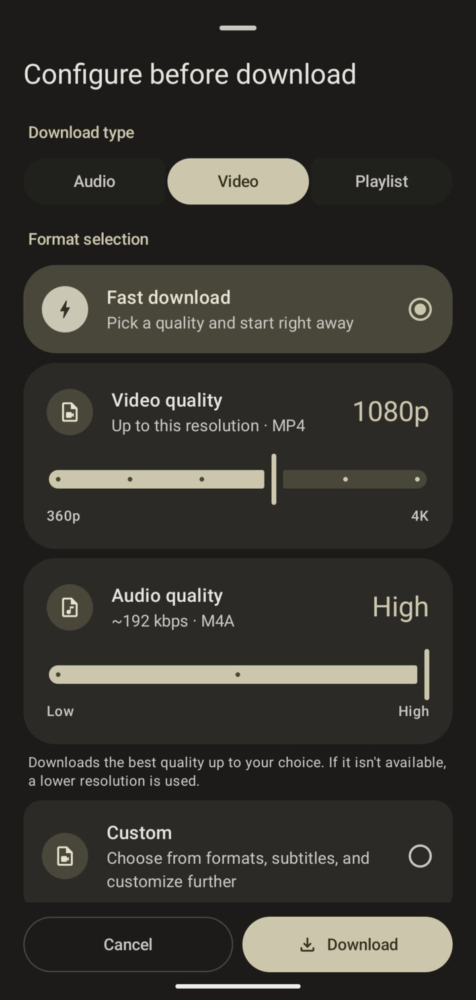
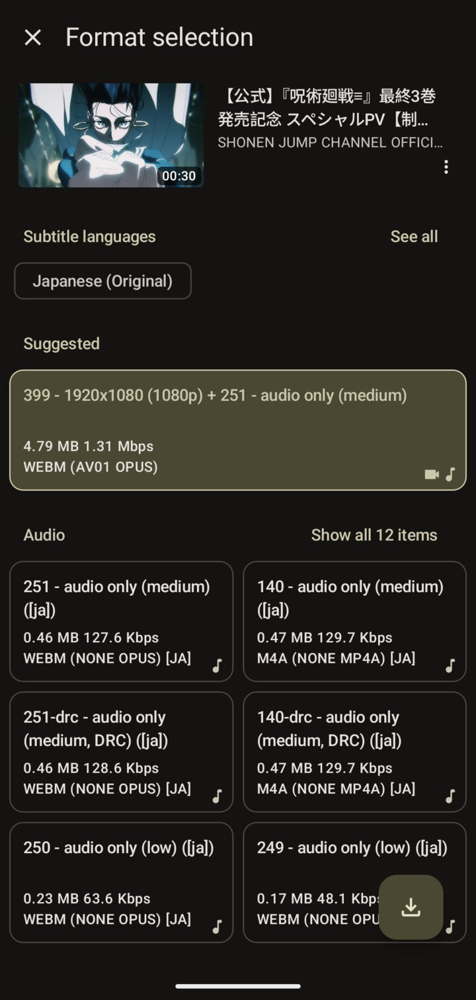
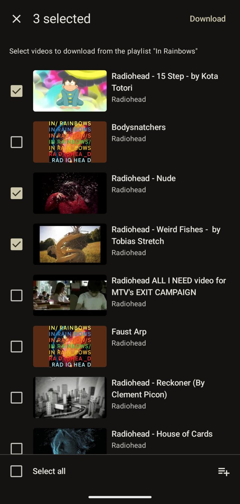
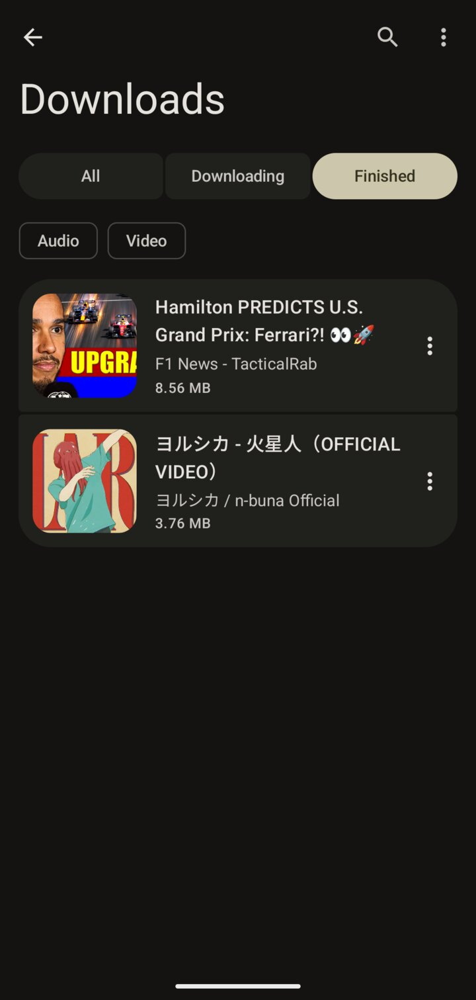
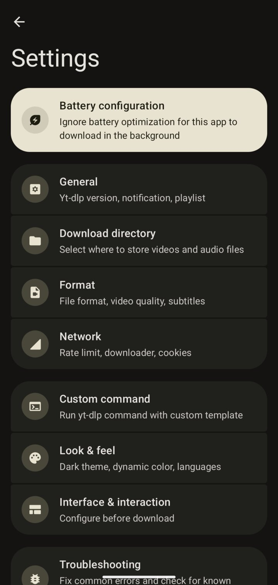
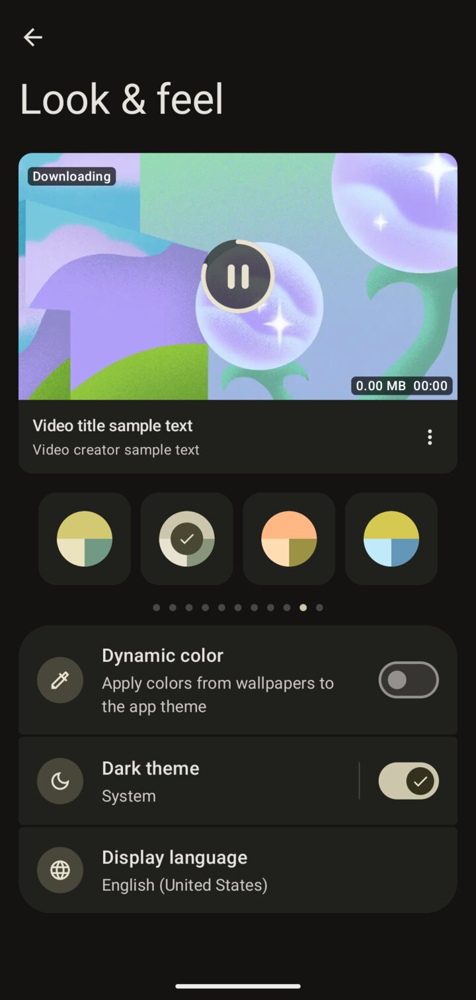

<div align="center">


# ReSeal

### Video/Audio Downloader for Android

A fork of [Seal](https://github.com/JunkFood02/Seal) with a faster download flow and a Material 3 Expressive interface.

[](https://github.com/yt-dlp/yt-dlp/blob/master/supportedsites.md)
[](LICENSE)

</div>

## 📱 Screenshots

<div align="center">






</div>

## ✨ What's new in ReSeal

- **Fast download.** Paste a link, set a video quality (360p to 4K) and an audio quality on two sliders, and the download starts right away. ReSeal fetches the best quality up to your choice and falls back to a lower one when it isn't available.
- **Custom, when you want control.** Pick exact video and audio formats and subtitle languages for a single video.
- **Playlists.** Choose which videos of a playlist to download.
- **Each link is extracted once.** The info fetched while you configure a download is reused for the download itself, so starting it doesn't wait for a second extraction.
- **Downloads page.** History and in-progress downloads in one list, filtered by status (All, Downloading, Finished) and by type, with an option to delete the files when you remove an entry.
- **Material 3 Expressive.** Segmented settings groups, connected button groups, expressive loading indicators and theme palettes, with dynamic color.
- **Reliable downloads.** Up to three downloads at once, a wake lock so they keep running with the screen off, and a cellular-data switch right in the download sheet.

## 📖 Features

- Download videos and audio from the sites supported by [yt-dlp](https://github.com/yt-dlp/yt-dlp).
- Embed metadata and thumbnails into audio files, and subtitles into videos.
- Use the embedded [aria2c](https://github.com/aria2/aria2) as an external downloader.
- Sign in through the built-in browser to download with your cookies.
- Run custom yt-dlp commands from templates.
- Written in Kotlin and Jetpack Compose: one activity, no fragments.

## ⬇️ Download

ReSeal has no published releases yet. Build it from source:

```bash
./gradlew assembleGenericDebug
adb install -r app/build/outputs/apk/generic/debug/Seal-*-generic-arm64-v8a-debug.apk
```

For most devices, use the **arm64-v8a** APK. The debug build installs next to the official Seal app.

## 🧱 Credits

ReSeal is built on [Seal](https://github.com/JunkFood02/Seal) by [JunkFood02](https://github.com/JunkFood02). If you like the app, consider [sponsoring the original author](https://github.com/sponsors/JunkFood02).

Seal is a GUI for [yt-dlp](https://github.com/yt-dlp/yt-dlp), based on [youtubedl-android](https://github.com/yausername/youtubedl-android).
Some UI designs and code are borrowed from [Read You](https://github.com/Ashinch/ReadYou) and [Music You](https://github.com/Kyant0/MusicYou).
Also uses [dvd](https://github.com/yausername/dvd), [Material color utilities](https://github.com/material-foundation/material-color-utilities) and [Monet](https://github.com/Kyant0/Monet).

Translations come from Seal's [Hosted Weblate](https://hosted.weblate.org/projects/seal/) project.

## 📃 License

ReSeal is licensed under the [GPLv3](LICENSE), like Seal.

> [!Warning]
>
> Except for the source code licensed under the GPLv3 license,
> all other parties are prohibited from using Seal's name as a downloader app,
> and the same is true for Seal's derivatives.
> Derivatives include but are not limited to forks and unofficial builds.
